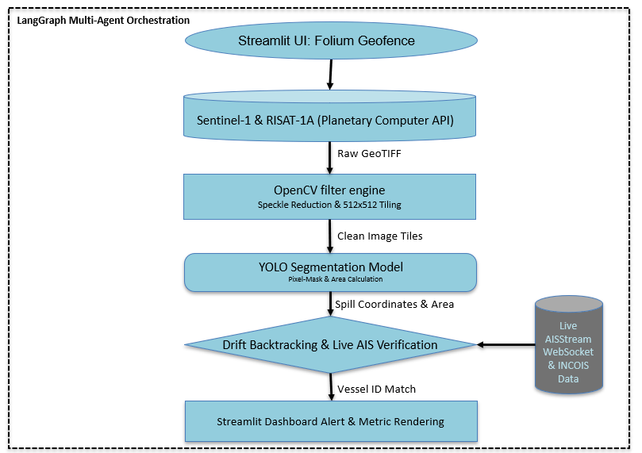

# Jal-Rakshak — Maritime Surveillance Engine

**AI-assisted oil spill detection, geospatial monitoring, and potential vessel attribution using satellite imagery and maritime telemetry.**

[](https://jal-rakshak.streamlit.app/)
[](https://www.python.org/)
[](https://opencv.org/)

Jal-Rakshak is a maritime surveillance project developed by a six-member team. It combines Synthetic Aperture Radar (SAR) imagery, computer vision, ocean-drift information, and live Automatic Identification System (AIS) telemetry to detect potential oil spills and support vessel attribution.

The system provides an interactive monitoring interface where operators define geographic areas of interest, retrieve satellite imagery, process image tiles, detect potential spills, and correlate detections with maritime and oceanographic data.

**Live Demo:** [jal-rakshak.streamlit.app](https://jal-rakshak.streamlit.app/)

## Table of Contents

- [Problem Statement](#problem-statement)
- [Key Features](#key-features)
- [System Architecture](#system-architecture)
- [Technical Workflow](#technical-workflow)
- [Technology Stack](#technology-stack)
- [Data Sources](#data-sources)
- [Installation and Setup](#installation-and-setup)
- [Limitations](#limitations)
- [Future Improvements](#future-improvements)
- [Contributors](#contributors)

## Problem Statement

Oil spills can cause significant environmental damage. Identifying their origins requires combining satellite observations with vessel movement data and oceanographic information.

Jal-Rakshak aims to streamline this process by integrating:

- Satellite-based observation of potential oil slicks.
- Image preprocessing and instance segmentation.
- Ocean-drift-informed backward trajectory analysis.
- AIS-based vessel correlation.
- An interactive dashboard for monitoring and alerts.

The goal is to support faster investigation and more informed maritime environmental monitoring.

## Key Features

### 1. Interactive Geofencing
- Define custom maritime monitoring zones using Streamlit and Folium.
- Restrict satellite imagery retrieval to areas of interest.

### 2. Satellite Imagery Ingestion
- Retrieve overlapping GeoTIFF imagery through STAC APIs.
- Support ESA Sentinel-1 imagery through Microsoft Planetary Computer and ISRO RISAT-1A imagery through Bhoonidhi, subject to data availability and endpoint access.

### 3. Image Preprocessing
- Divide raster imagery into **512 × 512 pixel tiles** using OpenCV.
- Apply speckle-noise reduction to help reveal potential oil-slick signatures associated with changes in radar backscatter.

### 4. YOLO-Based Instance Segmentation
- Integrate a YOLO instance segmentation model.
- Generate pixel-level masks for potential oil spills.
- Derive spill locations and surface-area estimates from segmentation outputs.

### 5. Data Fusion and Vessel Attribution
- Orchestrate the analysis workflow using LangGraph.
- Use ocean-drift information from INCOIS to support backward trajectory analysis.
- Cross-reference estimated spill-origin coordinates with live AIS telemetry to identify candidate vessels for further investigation.

### 6. Monitoring Dashboard
- Visualize geospatial information through Streamlit and Folium.
- Provide interactive geofencing and automated alerts to support operator workflows.

> Detection and vessel attribution are decision-support capabilities. Outputs require validation and should not be treated as definitive proof of an oil spill or a vessel's responsibility.

## System Architecture

The diagram below illustrates the high-level processing pipeline, from geofencing and satellite imagery ingestion to spill segmentation, vessel correlation, and dashboard alerts.



## Technical Workflow

1. **Define the area of interest:** Operators draw a custom monitoring zone using the interactive map.

2. **Retrieve satellite imagery:** STAC APIs locate and retrieve overlapping GeoTIFF imagery from supported satellite sources.

3. **Prepare the imagery:** OpenCV divides imagery into 512 × 512 pixel tiles and applies speckle-noise reduction.

4. **Detect potential spills:** An integrated YOLO instance segmentation model produces masks from which potential spill locations and surface areas can be estimated.

5. **Analyze possible origins:** LangGraph coordinates the workflow, using ocean-drift information from INCOIS to support backward trajectory modeling.

6. **Correlate vessel movements:** Estimated origin coordinates are cross-referenced with live AISStream telemetry to identify candidate vessels.

7. **Present results:** The Streamlit/Folium dashboard provides a geospatial interface for monitoring and alerts.

## Technology Stack

| Category | Technologies |
|---|---|
| Programming | Python |
| Computer Vision | OpenCV, YOLO instance segmentation |
| Workflow Orchestration | LangGraph |
| Geospatial Interface | Streamlit, Folium, streamlit-folium |
| Image Processing | NumPy, Pillow |
| Satellite Data Access | STAC APIs, GeoTIFF imagery |
| Maritime Telemetry | AISStream WebSocket |
| Oceanographic Data | INCOIS Online Oil Spill Advisory (OOSA) system |

## Data Sources

| Data | Source | Purpose |
|---|---|---|
| SAR imagery | ESA Sentinel-1 via Microsoft Planetary Computer | Satellite-based observation of potential oil slicks |
| SAR imagery | ISRO RISAT-1A via Bhoonidhi | Additional satellite imagery source |
| Training data | Roboflow Universe SAR Oil Spill Segmentation Dataset | Training data for the segmentation model |
| Vessel telemetry | AISStream WebSocket | Vessel positions and movement information |
| Oceanographic information | INCOIS Online Oil Spill Advisory (OOSA) system | Ocean-drift information for trajectory analysis |

Add direct links to the exact dataset pages, STAC collections, and API documentation used by the implementation.

## Installation and Setup

### Prerequisites

- Python installed in your environment.
- Access to the required satellite imagery and STAC endpoints.
- An AISStream WebSocket API key.
- Network access to the required data sources.

### 1. Clone the repository

```bash
git clone https://github.com/its-harshvardhan-singh/Jal-Rakshak.git
cd Jal-Rakshak
```

### 2. Install dependencies

```bash
pip install -r requirements.txt
```

The project dependencies include:

- `streamlit`
- `folium`
- `streamlit-folium`
- `ultralytics`
- `websocket-client`
- `langgraph`
- `opencv-python-headless`
- `numpy`
- `Pillow`

### 3. Configure credentials

Configure the AISStream WebSocket API key and any required STAC endpoint settings using the configuration mechanism expected by the application.

Document the exact environment variable names and configuration steps from `app.py`. Never commit API keys or other secrets to the repository.

### 4. Run the application

```bash
streamlit run app.py
```

The application includes a subprocess-based mechanism intended to unpack headless OpenCV into `/tmp` to work around read-only operating-system restrictions in the deployment environment.

Verify the deployment-specific behavior and supported environments before relying on this mechanism elsewhere.

## Limitations

### Environmental False Positives

Algal blooms, ocean upwelling, and low-wind conditions can produce radar signatures that resemble potential oil slicks. Additional oceanographic information, including Oceansat-derived data where available, may help distinguish these cases.

### Satellite Revisit Latency

The revisit intervals of satellite sources such as Sentinel-1 and RISAT can introduce delays between observations. Depending on acquisition availability and location, a spill may dissipate or move before it is detected.

### Computational Overhead

Processing large GeoTIFF scenes across broad ocean regions can be computationally expensive. Restricting inference to selected monitoring areas and relevant maritime shipping lanes can reduce unnecessary processing.

### Attribution Uncertainty

Backward trajectory modeling depends on the quality and availability of ocean-drift information. AIS data may also be incomplete or unavailable. Spatial and temporal correlation alone cannot establish legal responsibility.

### Model Generalization

Segmentation quality depends on training-data coverage, image conditions, and the model's ability to generalize to unseen scenes. Quantitative evaluation across independent scenes is necessary to characterize reliability.

## Future Improvements

Potential areas for further development include:

- Quantitative evaluation using segmentation metrics such as Intersection over Union (IoU), precision, and recall.
- More systematic analysis of environmental false positives.
- Integration of additional oceanographic and satellite-derived data sources.
- More efficient geospatial filtering and inference scheduling.
- Validation of vessel-correlation results against independent reference data.

These are potential improvements, not claims of completed implementation.

## Contributors

Jal-Rakshak was developed as a six-member team project.

1. **Harshvardhan Singh** — [GitHub](https://github.com/its-harshvardhan-singh)
2. **[Team Member 2]** — [GitHub Profile](#)
3. **[Team Member 3]** — [GitHub Profile](#)
4. **[Team Member 4]** — [GitHub Profile](#)
5. **[Team Member 5]** — [GitHub Profile](#)
6. **[Team Member 6]** — [GitHub Profile](#)

The repository is maintained by Harshvardhan Singh.

## Acknowledgements

- European Space Agency (ESA) — Sentinel-1 mission.
- Microsoft Planetary Computer — satellite data access.
- Indian Space Research Organisation (ISRO) — RISAT-1A mission and Bhoonidhi data access.
- Roboflow Universe — SAR oil-spill segmentation training dataset.
- AISStream — maritime telemetry access.
- Indian National Centre for Ocean Information Services (INCOIS) — oceanographic information.

---

**Project Repository:** [Jal-Rakshak on GitHub](https://github.com/its-harshvardhan-singh/Jal-Rakshak)

**Live Application:** [Jal-Rakshak Streamlit Demo](https://jal-rakshak.streamlit.app/)
